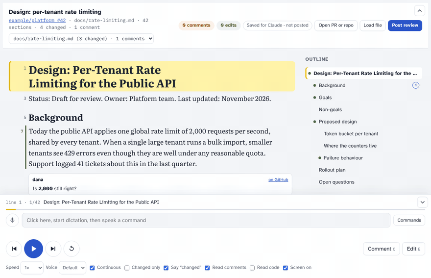
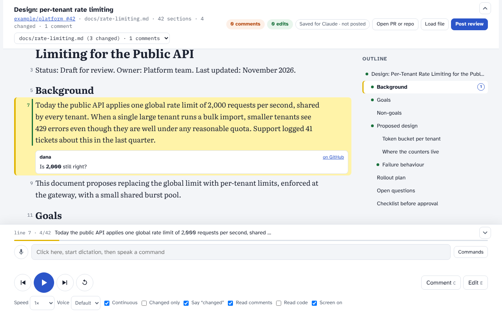
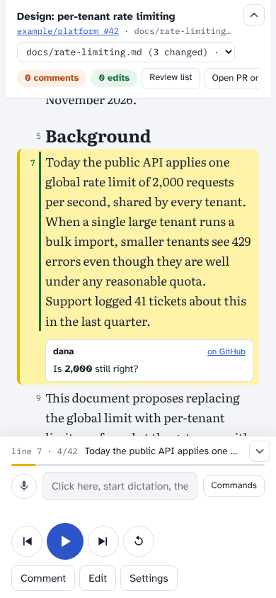

# claude-read-along

Review markdown with Claude by listening. A review page reads the document aloud section by section, highlights the sentence being spoken, and lets you jump, add comments and make edits by clicking, by keyboard or by dictated voice commands. Your comments and edits stay on the page until you ask Claude to post them to the pull request, and Claude asks before committing anything.

It works with GitHub pull requests (changed sections, existing review comments, several files), with the markdown of a repository or folder before any pull request exists, and with plain markdown files.



_The demo has no sound: on the page, each section is spoken aloud as it is highlighted._

> **Disclaimer.** You use this plugin at your own responsibility. When you confirm, it posts review comments and can push commits to GitHub under your account, so check what Claude shows you before confirming. It is provided as is, without warranty of any kind; see [LICENSE](LICENSE).

## Installation

### In the browser (claude.ai, Claude Code on the web)

1. On claude.ai, open **Customize**, then **Plugins**.
2. Choose **Add**, then **Add marketplace**, and enter `pinkasey/claude-read-along`.
3. Add the **read-along** plugin from that marketplace.
4. Start a new Claude Code session on the web; the plugin is available there.

### In a terminal

In a Claude Code terminal session:

```text
/plugin install read-along --marketplace pinkasey/claude-read-along
```

Or from a shell:

```bash
claude plugin install read-along --marketplace pinkasey/claude-read-along
```

Answer `y` to add the marketplace, then choose where to install it (your user scope makes it available everywhere). In the Claude desktop app, where `/plugin` does not run: click **+** next to the prompt box, then **Plugins**, **Add marketplace** with `pinkasey/claude-read-along`, then **Add plugin**.

`/plugin` commands do not run inside a Claude Code session on the web, and plugins declared in a repository's `.claude/settings.json` do not load there; use the browser steps above.

### Requirements

- Claude Code signed in with a claude.ai account, so Claude can publish your review page as a private claude.ai page (an Artifact).
- `python3` and the GitHub CLI `gh`, signed in to an account that can read the repository (and write to it, to commit edits). In Claude Code on the web, Claude attaches the repository to the session itself.
- A browser with speech synthesis: current Edge, Chrome and Safari have it. Edge on Windows has the most natural voices.

## Using it

Start in Claude Code with `/read-along:review`, or just ask, for example:

- "Review pinkasey/claude-read-along#1 with Read-Along"
- "Read me the docs folder of pinkasey/claude-read-along"
- "Read me docs/design.md"

The first time, Claude publishes your review page and gives you its link. You keep that one page for every review.

1. Open the page and press play, or click any section to read from there.
2. Add comments (**Comment**, the C key, or say "add comment …") and edits (**Edit**, E, or say "change X to Y") as you listen.
3. Say "post my review" in the chat, or press **Post review** on the page. Claude shows every comment and edit it will post, and asks before committing anything.

| Desktop | Phone |
| --- | --- |
|  |  |

To open the page again without asking Claude: use its link, find it in your artifacts at claude.ai/code/artifacts (`/artifacts` in the terminal), or ask Claude to pin it to your claude.ai sidebar. In the Claude Code app it can sit in the side pane, next to the chat.

## Features

- Section-by-section reading, with the sentence being spoken highlighted and kept in view; speed 0.8× to 3×, voice choice, keep the screen awake.
- Front matter and `<!-- comments -->`, which GitHub hides, are shown on the page; **Read hidden** reads them aloud too.
- Several reviews on one page: every pull request or repository you load is kept, and a picker switches between them instantly. A Claude session that works on a pull request adds it to your page by itself.
- An outline of headings; chapters with pull request changes are marked, with counts of review comments.
- Pull requests: changed sections are marked and announced ("Changed."), **Changed only** skips the rest, and existing review comments are read after their section (bots are shown, not read).
- Repositories: read the markdown of a repository or folder (any branch) without a pull request. Your first post creates a branch with your edits and comment markers and opens a draft pull request with your comments; later posts go to the same pull request. See [docs/features/repositories.md](docs/features/repositories.md).
- Your comments and edits, kept per file; edits can be proposed by voice ("change 2,000 to 3,000", "edit make this shorter").
- Voice commands, dictated with your operating system's dictation (Win+H on Windows, the keyboard microphone on phones) into the command box: play, pause, next, back, repeat, faster, slower, next chapter, next change, next comment, next file, go to line N, add comment …, undo.

## Posting a review

GitHub only accepts review comments on lines inside the pull request's diff. Three settings, in the page's **Post review** panel and saved per person, decide what happens:

| Setting | Default | Alternative |
| --- | --- | --- |
| Edits on changed lines | Suggested changes the author applies with one click | Committed to the pull request branch |
| Comments and edits on unchanged lines | Listed in the review summary with line numbers | Committed (a `<!-- review comment -->` marker for a comment, the edited text for an edit), with a review comment on it; the marker comes with a one-click removal |
| Add revert comments to committed edits | On: each committed edit gets a one-click revert | Off |

Claude always asks before committing. Pull requests from forks cannot be committed to, so those items become suggestions or summary entries.

## What works on the page alone

| On the page alone | Needs Claude |
| --- | --- |
| Listening, navigation, voice commands | Loading a pull request or repository (the page cannot reach GitHub) |
| Comments and edits | Posting the review, and committing edits |
| Opening or pasting a local markdown file | |
| Edits proposed by voice, which ask Claude directly from the page | |

## Known limits

- The page's **Open PR or repo** and **Post review** buttons are meant to send the request to your Claude Code session, but this does not work yet: claude.ai refuses the connector call. Each panel shows the sentence to paste into the chat instead, which works.
- The page cannot use the microphone itself, so voice commands use your operating system's dictation into the command box.
- Speech usually stops when a phone's screen locks; the page keeps the screen awake while reading.

## What's in this repository

| Path | What it is |
| --- | --- |
| `.claude-plugin/` | The plugin manifest and the marketplace file that make the repository installable |
| `skills/review/SKILL.md` | The skill: how Claude publishes the page, loads documents and posts reviews |
| `page/read-along-review.html` | The review page |
| `tools/pr_loader.py` | Loads a pull request's markdown files, changed lines and review comments (or local files) for the page |
| `tools/post_review.py` | Plans a review (changing nothing), then posts it |
| `docs/` | How Read-Along behaves: product overview, one document per feature area, security. Start at [docs/README.md](docs/README.md). |
| `tools/demo/record.js` | Records the screenshots and demo in `docs/images/` from the real page |
| `examples/` | A sample design document to try it on |
| `tests/`, `tools/ci/`, `.github/workflows/` | Tests and CI; see [docs/development.md](docs/development.md) |

### Running the scripts directly

```bash
python3 tools/pr_loader.py pr OWNER/REPO NUMBER OUT_DIR
```

```bash
python3 tools/pr_loader.py repo OWNER/REPO OUT_DIR --ref BRANCH --path FOLDER
```

```bash
python3 tools/pr_loader.py local OUT_DIR path/to/file.md
```

```bash
python3 tools/post_review.py plan --pr OWNER/REPO NUMBER --data EXPORT_DIR --edit-mode suggest --outside summary --revert-comments on --out plan.json
```

For a repository review, use `--repo OWNER/REPO --ref BRANCH --folder FOLDER` instead of `--pr` (add `--review-pr N` once the review pull request exists).

```bash
python3 tools/post_review.py execute --plan plan.json --out result.json --repo-dir path/to/clone
```

## License

[MIT](LICENSE). Use at your own responsibility; see the disclaimer above.
